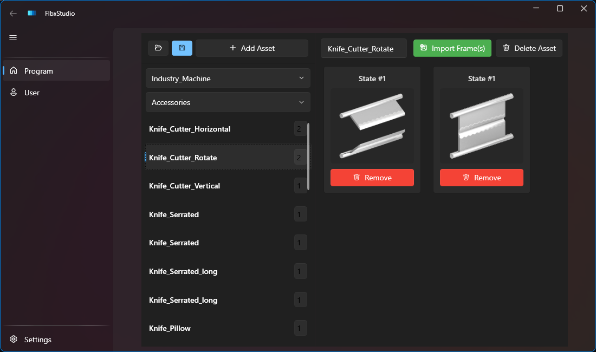

# FlbxStudio

FlbxStudio is a WPF desktop tool for opening, inspecting, and editing Weintek `.flbx` picture library files.

Current baseline: **beta-ready**.

## Screenshot

## Current status

- Supports loading FLBX files with catalog-based and inline/trailing asset variations.
- Supports multi-asset libraries such as `Conveyors.flbx`.
- Supports separate Program and User library workflows from dedicated navigation pages.
- Supports importing/removing state images and saving updated libraries.
- Save dialogs now default to the active FLBX filename and folder.
- Settings includes configurable Program/User library root paths.

## Usage

1. Open **Settings** and configure:
   - **EasyBuilder Library Path** (Program libraries)
   - **User Library Path** (User libraries)
   - Click **Save** on each tab after changes.
2. Go to **Program** or **User** from the left navigation.
3. In the page header:
   - Use **Open FLBX Library** to open a file directly, or
   - Pick a folder and then a file from the two combo boxes (selecting a file loads it).
4. Edit assets:
   - Select an asset from the left list.
   - Rename in the asset name box.
   - Use **Add Asset** to create a new asset.
   - Use **Import Frame(s)** to add PNG/BMP states.
   - Use **Remove** on a state card to delete a state.
   - Use **Delete Asset** to remove the selected asset.
5. Click **Save FLBX Library** to save.
   - The dialog defaults to the current FLBX filename and folder when available.

## Future features (planned)

### Near-term priorities

- [ ] Duplicate state action (clone an existing state in the selected asset)
- [ ] PNG color changer for quick recolor workflows
- [ ] Create new states directly from duplicated states with color edits
- [ ] Export state images to PNG for external editing

### Later roadmap

- [ ] PNG creator for generating new state images inside the app
- [ ] Lightweight state editing tools to speed up HMI asset iteration

# Building

## Prerequisites

- .NET 10 SDK
- Windows (WPF desktop target)

## Build (debug)

From repository root:

`dotnet build FlbxStudio/FlbxStudio.csproj -c Debug`

## Publish self-contained EXE (recommended)

`dotnet publish FlbxStudio/FlbxStudio.csproj -c Release -r win-x64 --self-contained true`

Output:

`FlbxStudio/bin/Release/net10.0-windows/win-x64/publish/`

## Publish self-contained single-file EXE

Single-file:

`dotnet publish FlbxStudio/FlbxStudio.csproj -c Release -r win-x64 --self-contained true /p:PublishSingleFile=true /p:IncludeNativeLibrariesForSelfExtract=true /p:EnableCompressionInSingleFile=true`

Output:

`FlbxStudio/bin/Release/net10.0-windows/win-x64/publish/`

## Single-file notes

- Startup can be slightly slower than multi-file publish.
- Some native/runtime components may be extracted at runtime.
- Do not enable trimming for this WPF app unless fully validated.

## Contributing and issue reporting

- Contributing guide: [CONTRIBUTING.md](CONTRIBUTING.md)
- Bug reports: use the **Bug report** issue template
- Feature ideas: use the **Feature request** issue template
